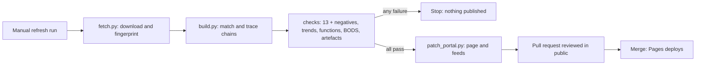
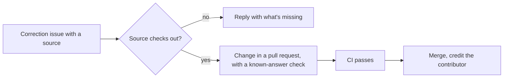

# Service blueprint and workflows

## Blueprint

| Stage | User does | Front stage (page) | Back stage (build) | Support (sources and checks) |
|---|---|---|---|---|
| Arrive | Searches or follows a link | Search, assistant, question-led tiles | Static page, no server | GitHub Pages |
| Find | Opens a body | Profile with chain, money, ownership | Chains precomputed in `data/tree.json` | build.py, 13 checks |
| Check | Reads the evidence | Each link names its source and place | Manifest with SHA-256 per source | fetch.py, c_hashes |
| Reuse | Downloads or calls the feed | Data page, formats, contract | BODS, CSV, JSON-LD, concordance | export_bods.py, schema check |
| Correct | Raises a correction | Form on GitHub | Issue triaged, change proposed in a pull request | CI runs every check before merge |

## Workflows

**Effort to run (one person):** a refresh with review takes about an hour; triaging a correction takes 10–20 minutes. Nothing runs on a schedule, so nothing breaks unattended.
