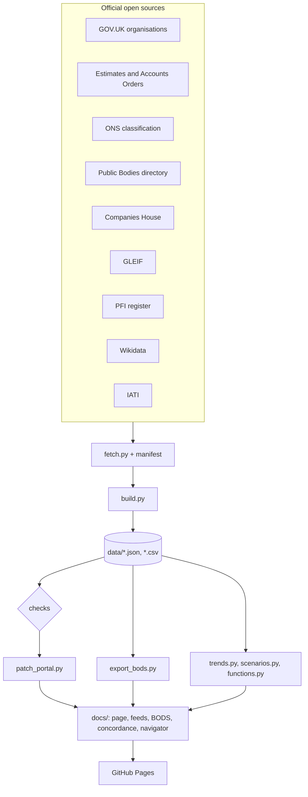

# Solution architecture

**Shape.** A static, file-based pipeline in one public repository. There is no server, database or account to run, so the attack surface is the repository and the published files.

**Key decisions**

| Decision | Why | Trade-off |
|---|---|---|
| Static site on GitHub Pages | Free, no maintenance, nothing to patch | No server-side search or write-back |
| Source files that name people are fetched, not committed | Keeps personal data out of the repository | A rebuild needs network access |
| Safe-fail matching (no fuzzy joins) | A wrong join is worse than a gap | 884 names left unresolved, each listed |
| BODS 0.4 with a public-accountability extension | An existing open standard, with tooling | The extension isn't part of the standard yet |
| Manual refresh, no schedule | A one-person band can't nurse failing scheduled jobs | Freshness depends on someone running it |

**Security.** Workflows read-only; actions pinned to commit SHAs; dependencies pinned; output escaped; no evaluation of input; ruff with security rules; fail closed.
